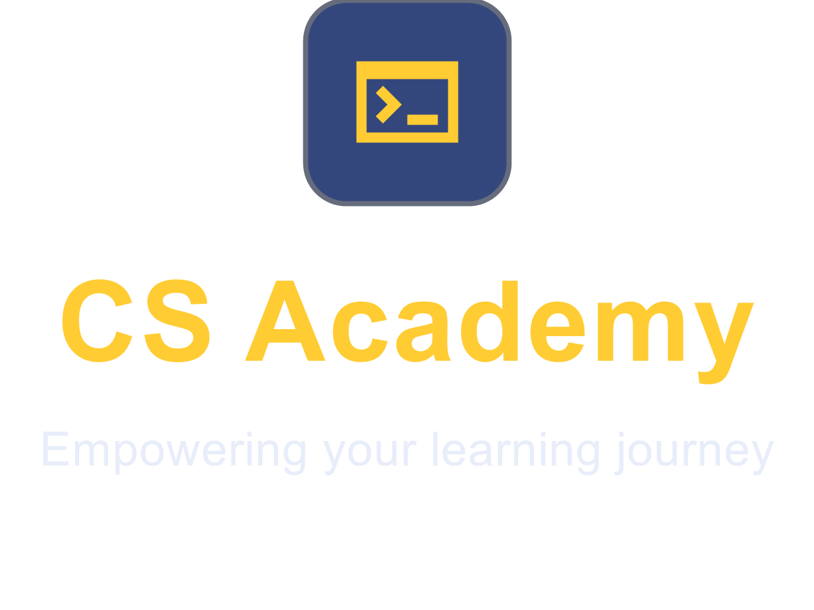
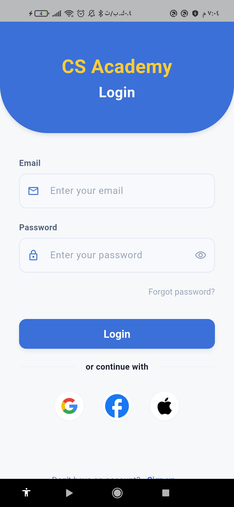
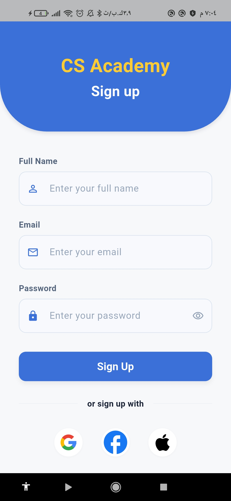
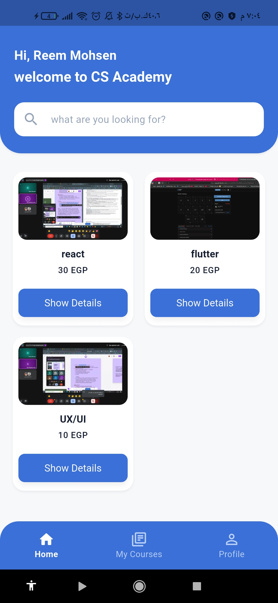
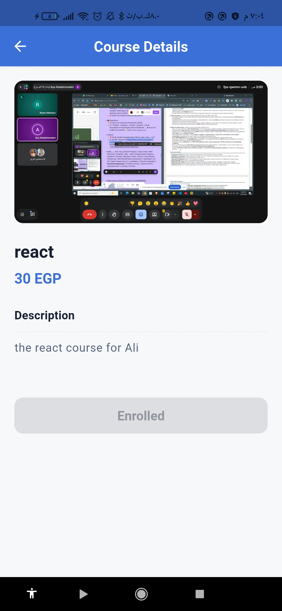
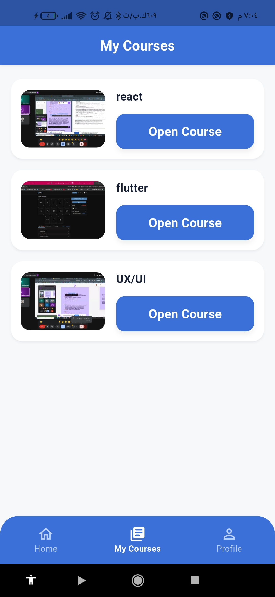
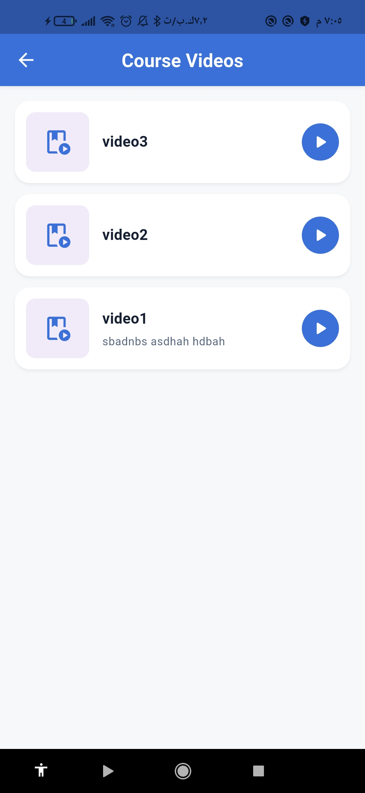
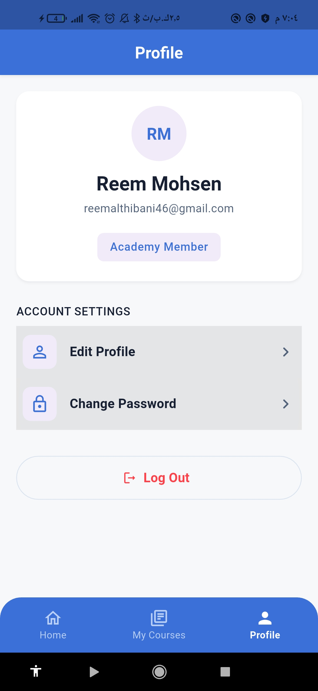
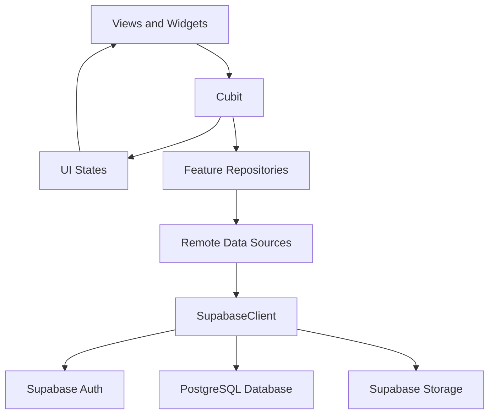

<p align="center">
  
</p>

<h1 align="center">🎓 E-Learning — Online Learning App</h1>

<p align="center">
  A Flutter training project at CS Academy.
</p>

<p align="center">
  
  
  
  
</p>

<p align="center">
  <a href="#about">About</a> ·
  <a href="#features">Features</a> ·
  <a href="#learning">Learning Experience</a> ·
  <a href="#screenshots">Screenshots</a> ·
  <a href="#architecture">Architecture</a> ·
  <a href="#tech-stack">Tech Stack</a> ·
  <a href="#getting-started">Getting Started</a>
</p>

---

<a id="about"></a>

## 🎓 About the App

**E-Learning** is an online learning application developed as part of the **Flutter training program at CS Academy**. The project puts Flutter concepts into practice, from building interfaces and managing state to connecting authentication, course data, and video content to Supabase.

The learning experience includes account registration, course browsing and search, course enrollment, a personal course library, video lessons, and profile editing, with a light Material 3 theme.

This repository documents the app's implemented features and the Flutter skills applied throughout the project.

<a id="features"></a>

## ✨ Key Features

- 🚀 **Native Splash** — CS Academy artwork displayed while the app initializes.
- 🔐 **Authentication** — Email sign-up and login through Supabase Auth, with form validation and logout.
- 🏠 **Course Browsing** — A course catalog with images, titles, prices, and pull-to-refresh.
- 🔍 **Search** — Filter loaded courses by title or description as you type.
- 📖 **Course Details** — View a course's image, description, and price before enrolling.
- 📝 **Course Enrollment** — Start a course and save the enrollment to the current user's account, with checks for existing enrollments.
- 📚 **My Courses** — Browse enrolled courses and open their lessons from a personal course library.
- 🎬 **Video Lessons** — Ordered lesson lists and an in-app player with play, pause, and a seekable progress bar. Private Storage videos use temporary signed URLs.
- 👤 **Profile** — View and update the name, email, and password through Supabase Auth.
- 🧭 **Bottom Navigation** — Switch between Home, My Courses, and Profile while keeping each tab's view alive.

<a id="learning"></a>

## 📚 Learning Experience

The project provided practical experience with:

- Building Flutter screens using reusable widgets, shared themes, and responsive layouts.
- Managing UI state with **Cubit**, `BlocBuilder`, `BlocListener`, and `BlocConsumer`.
- Connecting authentication, database queries, and file storage through **Supabase**.
- Converting backend responses into Dart models and separating data access through repositories and remote data sources.
- Registering dependencies and creating Cubits with **GetIt**.
- Handling request results with **Dartz** `Either<Failure, T>` and shared error mapping.
- Implementing navigation, form validation, paginated data fetching, local search, and loading, empty, and error states.
- Managing video playback controllers and generating signed URLs for private course videos.
- Organizing the code by feature to keep related screens, state logic, and data operations together.

<a id="screenshots"></a>

## 📱 Screenshots

A look at the app screens. Select any screenshot to view it at full size:

<table>
  <tr>
    <td align="center" width="33%">
      <a href="assets/screenshots/login.jpg"></a>
      <br /><b>Login</b>
    </td>
    <td align="center" width="33%">
      <a href="assets/screenshots/sign-up.jpg"></a>
      <br /><b>Sign Up</b>
    </td>
    <td align="center" width="33%">
      <a href="assets/screenshots/home.jpg"></a>
      <br /><b>Home</b>
    </td>
  </tr>
  <tr>
    <td align="center" width="33%">
      <a href="assets/screenshots/course-details.jpg"></a>
      <br /><b>Course Details</b>
    </td>
    <td align="center" width="33%">
      <a href="assets/screenshots/my-courses.jpg"></a>
      <br /><b>My Courses</b>
    </td>
    <td align="center" width="33%">
      <a href="assets/screenshots/course-videos.jpg"></a>
      <br /><b>Course Videos</b>
    </td>
  </tr>
  <tr>
    <td align="center" colspan="3">
      <a href="assets/screenshots/profile.jpg"></a>
      <br /><b>Profile</b>
    </td>
  </tr>
</table>

## 🏛️ App Architecture

The codebase follows a **feature-based structure**. Each feature separates its data access from its presentation code, while `core` provides dependency injection, networking setup, error handling, routing, themes, and shared utilities.



**GetIt** supplies the dependencies used by repositories, data sources, and Cubits. Repository requests use a shared `requestHandler` to return either a `Failure` or a successful result. The supplied Supabase SQL script defines row-level security policies for course data, enrollments, and private video access.

### Project Structure

```text
lib/
├── main.dart                  # Application entry point
├── e_learning.dart            # App configuration
├── core/
│   ├── common/                # Shared validation utilities
│   ├── constants/             # Shared strings and preference keys
│   ├── dependency_injection/  # GetIt registrations
│   ├── extensions/            # Screen and snackbar helpers
│   ├── networking/            # Supabase initialization
│   ├── routing/               # Navigation
│   ├── services/              # Request handling, errors, and preference helper
│   └── themes/                # Colors and Material theme
└── features/
    ├── auth/
    ├── course_videos/
    ├── home/
    ├── main_home/
    ├── my_courses/
    └── Profile/
```

Features with backend operations group models, remote data sources, and repositories in `data`, and views, widgets, and Cubits in `presentation`. Splash images are stored in `assets/splash/`, and Supabase setup files are stored in `docs/`.

<a id="tech-stack"></a>

## 🛠️ Tech Stack

| Purpose | Technology |
| :--- | :--- |
| UI & Language | Flutter, Dart |
| State Management | Cubit / flutter_bloc |
| Authentication | Supabase Auth |
| Database | Supabase PostgreSQL |
| Video Storage | Supabase Storage with signed URLs |
| Video Playback | video_player |
| Dependency Injection | get_it |
| Result Handling | dartz / Either |
| Navigation | Flutter Navigator |
| Styling | Material 3, shared light theme |
| Native Splash | flutter_native_splash |

Package versions are listed in [pubspec.yaml](pubspec.yaml).

<a id="getting-started"></a>

## 🚀 Getting Started

### Prerequisites

- Flutter with Dart `>=3.10.4 <4.0.0`.
- Git and an editor such as VS Code or Android Studio.
- An Android emulator or connected device. For iOS, use macOS and Xcode.
- An internet connection for dependencies and Supabase requests.
- Access to a Supabase project with authentication, course tables, and video storage configured.

### Run Locally

```bash
git clone https://github.com/ReemMohsn/E-Learning.git
cd E-Learning
flutter pub get
```

Use `flutter doctor` to check your setup and `flutter devices` to list available devices.

### Supabase Setup

The Supabase connection is configured in [supabase_service.dart](lib/core/networking/supabase_service.dart). To use your own project, update `_supabaseUrl` and `_supabaseKey` with your project's URL and publishable key.

For a new backend, follow the [Arabic Supabase setup guide](docs/supabase_learning_setup_ar.md):

1. Run [supabase_learning_setup.sql](docs/supabase_learning_setup.sql) in the Supabase SQL Editor to create the `courses`, `enrollments`, and `course_videos` tables and their access policies.
2. Add course records to `courses`; the SQL script creates the schema without sample content.
3. Create a private Storage bucket named `course-videos` and upload lessons using paths such as `<course_id>/<file_name>.mp4`.
4. Add the corresponding `course_videos` records with their `video_path` and lesson `position`.

Once the backend is ready, launch the app:

```bash
flutter run
```

On first launch, create an account, confirm your email if required by the Supabase project, then sign in. Open a course from **Home**, select **Start Course**, and access its lessons from **My Courses**.

## 👩‍💻 Author

[ReemMohsn](https://github.com/ReemMohsn)

Built during the Flutter training program at **CS Academy**.
